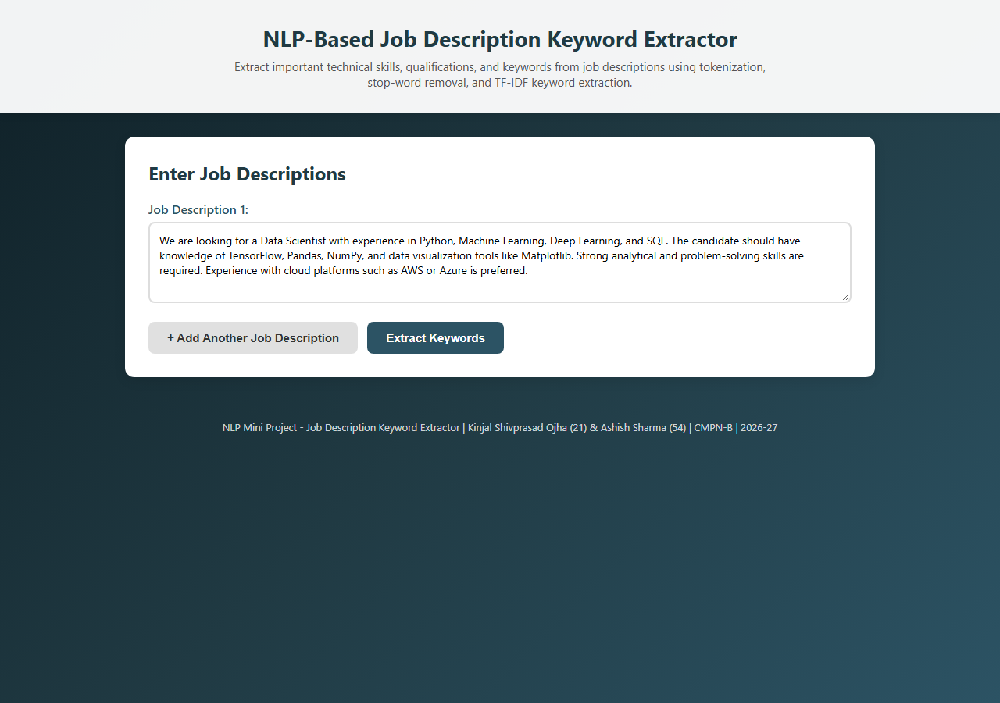
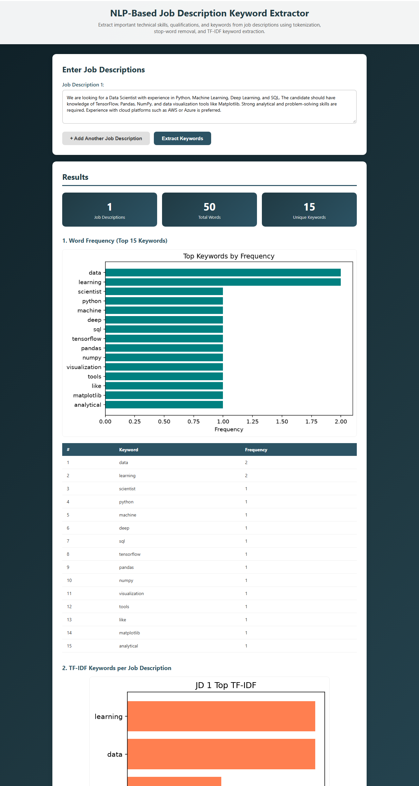
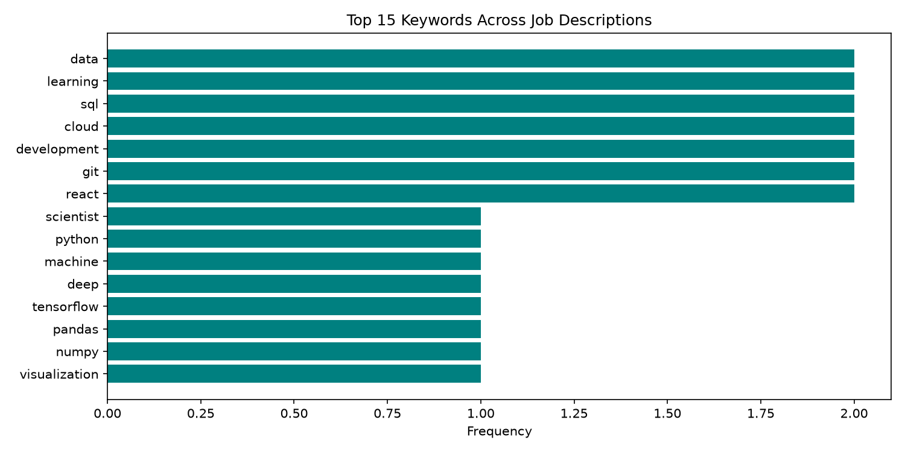
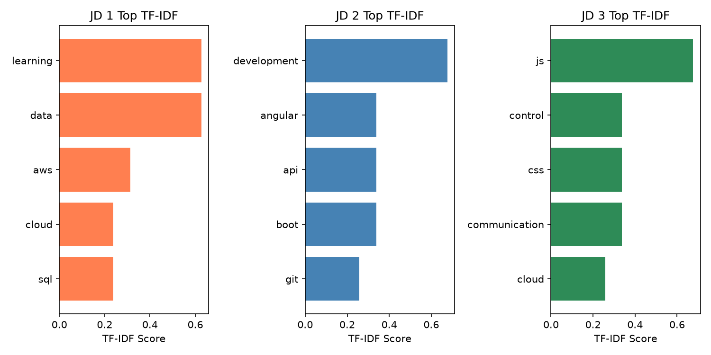
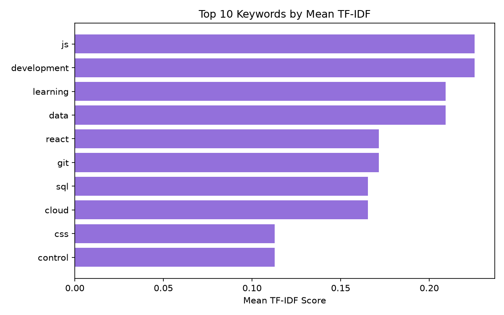

# NLP-Based Job Description Keyword Extractor

> An NLP Mini Project (Semester VII, B.E. CMPN) that processes job descriptions and extracts important technical skills, qualifications, and keywords using **Tokenization**, **Stop-Word Removal**, and **TF-IDF Keyword Extraction**.

**Team:**
- Mr. Kinjal Shivprasad Ojha (Roll No. 21)
- Mr. Ashish Sharma (Roll No. 54)

**Guide:** Ms. Rujuta Vartak | **Academic Year:** 2026-27
**Department of Computer Engineering**, Shree L. R. Tiwari College of Engineering

---

## Table of Contents

- [Problem Statement](#problem-statement)
- [Features](#features)
- [Tech Stack](#tech-stack)
- [Project Structure](#project-structure)
- [How to Run](#how-to-run)
- [How It Works (Pipeline)](#how-it-works-pipeline)
- [Screenshots](#screenshots)
- [API Reference](#api-reference)
- [Standalone Script Mode](#standalone-script-mode)
- [Mini Project Report](#mini-project-report)

---

## Problem Statement

To develop an NLP-based Job Description Keyword Extractor that processes job descriptions and extracts important technical skills, qualifications, and keywords using tokenization, stop-word removal, and keyword extraction techniques. The system aims to help students understand employer requirements and identify the skills needed for a particular job role.

---

## Features

- **Multi-JD Input** - Add any number of job descriptions dynamically (Add/Remove buttons), with 3 sample JDs pre-filled (Data Scientist, Software Developer, Web Developer)
- **Word Frequency Analysis** - Counts and ranks the top 15 keywords after stop-word removal across all JDs
- **TF-IDF Keyword Extraction** - Computes top 5 distinctive keywords *per job description* using TfidfVectorizer
- **Mean TF-IDF Ranking** - Ranks the top 10 keywords by average TF-IDF score across all JDs
- **Auto-Generated Charts** - 3 matplotlib charts (frequency, per-JD TF-IDF, mean TF-IDF) rendered as base64 images in the browser
- **Statistics Dashboard** - Stat cards showing JD count, total words processed, and unique keywords found
- **REST API** - JSON API (`POST /api/extract`) for programmatic access
- **Modern Responsive UI** - Gradient design, loading spinner, smooth scrolling, keyword score badges

---

## Tech Stack

| Layer | Technology |
|---|---|
| Backend | Python 3.14, Flask 3.1 |
| NLP / ML | scikit-learn (TfidfVectorizer), collections.Counter, re |
| Visualization | Matplotlib (headless Agg backend) |
| Frontend | HTML5, CSS3 (custom responsive design), Vanilla JavaScript (Fetch API) |
| Report | python-docx, PyMuPDF, Microsoft Word COM (DOCX → PDF) |

---

## Project Structure

```
NLP_MiniProject_JobKeywordExtractor/
│
├── app.py                            # Flask backend: routes + NLP engine + chart generation
├── requirements.txt                  # Python dependencies
│
├── templates/
│   └── index.html                    # Frontend page (Jinja2 template)
│
├── static/
│   ├── style.css                     # UI styling (gradient theme, cards, tables)
│   └── script.js                     # Client logic: JD form, fetch API, render results
│
├── docs_screenshots/
│   ├── ui_landing.png                # Home page screenshot
│   └── ui_results.png                # Results page screenshot
│
├── MiniProject_KeywordExtractor.py   # Standalone CLI script version (no server)
├── build_miniproject_report.py       # Generates the DOCX mini project report
├── docx2pdf_miniproject.py           # Converts report DOCX to PDF via Word COM
│
├── NLP_MiniProject_Report_Kinjal_Ashish.docx   # Mini project report (editable)
├── NLP_MiniProject_Report_Kinjal_Ashish.pdf    # Mini project report (print-ready)
│
├── proj_word_freq.png                # Standalone graph: word frequency
├── proj_tfidf_jd.png                 # Standalone graph: per-JD TF-IDF
└── proj_mean_tfidf.png               # Standalone graph: mean TF-IDF
```

---

## How to Run

### Prerequisites
- Python **3.10+** (tested on 3.14.5)
- pip

### Steps

```bash
# 1. Clone the repository
git clone https://github.com/Kinjal2004-Hu/NLP_Project.git
cd NLP_Project

# 2. (Optional) Create a virtual environment
python -m venv venv
venv\Scripts\activate        # Windows
# source venv/bin/activate   # macOS/Linux

# 3. Install dependencies
pip install -r requirements.txt

# 4. Start the Flask server
python app.py
```

### 5. Open the app

Visit **http://127.0.0.1:5000** in your browser.

### Using the app

1. The page loads with **3 sample job descriptions** pre-filled (you can edit or paste your own JDs).
2. Click **"+ Add Another Job Description"** to add more inputs, or **"Remove"** to delete one.
3. Click **"Extract Keywords"**.
4. Wait for the spinner - the **Results** section appears with:
   - Stat cards (JDs / Total Words / Unique Keywords)
   - Word frequency chart + table
   - Per-JD TF-IDF chart + keyword badges
   - Mean TF-IDF chart + table

> **Demo shortcut:** open `http://127.0.0.1:5000/?auto=1` to auto-run extraction on page load.

---

## How It Works (Pipeline)

```
Input Job Descriptions (raw text)
        │
        ▼
1. Lowercase conversion  (text.lower())
        │
        ▼
2. Punctuation / special character removal  (re.sub(r'[^a-zA-Z\s]', ''))
        │
        ▼
3. Tokenization  (whitespace split into words)
        │
        ▼
4. Stop-word removal  (custom STOP_WORDS set: articles, pronouns,
   verbs + JD fillers like 'candidate', 'experience', 'required')
   + length filter (word length > 2)
        │
        ├──────────────────────────────┐
        ▼                              ▼
5a. Word Frequency              5b. TF-IDF Vectorization
    (Counter.most_common(15))       (sklearn TfidfVectorizer,
                                     max_features=15)
        │                              │
        ▼                              ▼
6. Top-15 keywords             Top-5 per JD + Top-10 by mean TF-IDF
        │                              │
        └──────────────┬───────────────┘
                       ▼
7. Matplotlib charts → base64 PNG → JSON response → Browser renders
```

**Why TF-IDF?** Term Frequency counts how often a word appears in a JD, while Inverse Document Frequency down-words words that appear in *every* JD. The product highlights words that are *distinctive* to each job role (e.g., `tensorflow` for Data Scientist vs `kubernetes` for Software Developer).

---

## Screenshots

### Home Page



### Results Page (charts, tables, stat cards)



### Generated Graphs (standalone versions)

**Word Frequency (top 15 keywords across all JDs):**



**TF-IDF per Job Description:**



**Top Keywords by Mean TF-IDF:**



### Sample Output (CLI)

```
Top 15 Keywords Across All Job Descriptions:
  data: 2
  learning: 2
  sql: 2
  cloud: 2
  development: 2
  git: 2
  react: 2
  ...

TF-IDF Top Keywords per Job Description:

JD 1 (Data Scientist):
  learning: 0.6276
  data: 0.6276
  aws: 0.3138
  cloud: 0.2386
  sql: 0.2386

JD 2 (Software Developer):
  development: 0.6767
  angular: 0.3383
  api: 0.3383
  boot: 0.3383
  git: 0.2573

JD 3 (Web Developer):
  js: 0.6767
  control: 0.3383
  css: 0.3383
  communication: 0.3383
  cloud: 0.2573
```

---

## API Reference

### `GET /`
Serves the frontend page.

### `POST /api/extract`
Extracts keywords from one or more job descriptions.

**Request:**
```json
POST /api/extract
Content-Type: application/json

{
  "job_descriptions": [
    "We are looking for a Data Scientist with experience in Python...",
    "Job Description: Software Developer required..."
  ]
}
```

**Response (200 OK):**
```json
{
  "num_jds": 2,
  "total_words": 87,
  "results": {
    "word_frequency": [{ "word": "data", "count": 2 }, ...],
    "jd_keywords": [
      [{ "term": "learning", "score": 0.6276 }, ...],
      [{ "term": "development", "score": 0.6767 }, ...]
    ],
    "mean_tfidf": [{ "term": "data", "score": 0.3138 }, ...]
  },
  "charts": {
    "frequency": "<base64 png>",
    "tfidf": "<base64 png>",
    "mean": "<base64 png>"
  }
}
```

**Errors:**
- `400 Bad Request` - `{"error": "No job descriptions provided"}` when all inputs are empty.

**Quick test (PowerShell):**
```powershell
$body = @{ job_descriptions = @("We need a Python developer with Django and PostgreSQL.") } | ConvertTo-Json
Invoke-RestMethod -Uri http://127.0.0.1:5000/api/extract -Method Post -Body $body -ContentType "application/json"
```

---

## Standalone Script Mode

Run the NLP pipeline **without the web server** (prints results + saves PNG graphs to disk):

```bash
python MiniProject_KeywordExtractor.py
```

Output:
- Top 15 keywords by frequency (console)
- Top 5 TF-IDF keywords per JD (console)
- `proj_word_freq.png`, `proj_tfidf_jd.png`, `proj_mean_tfidf.png`

---

## Mini Project Report

The complete 15-page mini project report (Title page, Approval, Declaration, Table of Contents, Introduction, System Architecture, Implementation, Technologies Used, Results, Conclusion, References) is included:

- `NLP_MiniProject_Report_Kinjal_Ashish.docx` - editable
- `NLP_MiniProject_Report_Kinjal_Ashish.pdf` - print-ready

Regenerate after code changes:
```bash
python build_miniproject_report.py     # rebuild DOCX
python docx2pdf_miniproject.py         # convert to PDF (requires MS Word)
```

---

## Conclusion

The system uses tokenization to split text into smaller units, stop-word removal to eliminate common words, and TF-IDF keyword extraction to identify important skills and qualifications from job descriptions. This application can help students plan their careers, identify skill gaps, and prepare more effectively for job opportunities.

---

## References

1. Bird, S., Klein, E., and Loper, E. *Natural Language Processing with Python.* O'Reilly Media, 2009.
2. Manning, C. D., Raghavan, P., and Schutze, H. *Introduction to Information Retrieval.* Cambridge University Press, 2008.
3. scikit-learn Documentation: [TF-IDF Vectorizer](https://scikit-learn.org/stable/modules/feature_extraction.html)
4. Jurafsky, D. and Martin, J. H. *Speech and Language Processing.* 3rd Edition, 2023.
5. Flask Documentation: https://flask.palletsprojects.com/

---

## License

This project is submitted as academic coursework for the NLP Mini Project, Semester VII, B.E. CMPN.
